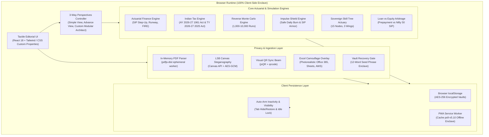

# PsFi System Architecture & Cryptographic Manual

This document details the architectural principles, cryptographic enclaves, actuarial engines, and state management models powering **PsFi (Pseudo Finance Control Center)**.

---

## 1. High-Level System Architecture

PsFi is constructed on a **Zero-Server, Local-First Enclave** topology. The entire application runs natively inside the client's browser runtime with zero reliance on cloud databases, remote API gateways, or tracking servers.

---

## 2. Cryptographic Enclave & Privacy Specifications

### 2.1 Zero-Cloud Isolation Model
- **No Remote Endpoints:** PsFi initiates zero outbound network calls containing user state.
- **In-Memory Document Extraction:** Financial statements (Mutual Fund CAS, Bank PDFs, Credit Card bills, Payslips) are extracted into ephemeral typed arrays via `pdfjs-dist`. Text tokens are processed in volatile memory, extracted into financial balances, and immediately eligible for garbage collection. No document bytes are stored in `localStorage` or transmitted over HTTP.

### 2.2 Master PIN & AES-256-GCM Vault Enclave
- When an account is created or PIN-locked:
  1. A cryptographically random 16-byte salt is generated via `window.crypto.getRandomValues`.
  2. The candidate PIN is derived using **PBKDF2 with 600,000 iterations of HMAC-SHA-256**.
  3. Vault states are encrypted using **AES-256-GCM** with a distinct 12-byte initialization vector (IV) per save.
  4. Authentication tags verify ciphertext integrity at rest; any tampering results in rejection.

### 2.3 Vault Recovery Gate & 12-Word Seed Phrases
- When switching devices or recovering from storage lockouts:
  - `VaultRecoveryGate.tsx` provides an air-gapped cryptographic interface.
  - Automatically detects 12-word BIP39-style recovery phrases via regular expression regex parsing.
  - Employs zero-knowledge key derivation without exposing plaintext keys to browser history or global variables.
  - Includes an emergency demo vault bypass allowing users to inspect the application without risk of dead ends.

### 2.4 Auto-Arm Inactivity & Tab Visibility Protection
- Active vaults automatically lock under three distinct triggers:
  1. **Tab Hide / Window Minimization:** Listens to `document.visibilitychange`; when `document.hidden` becomes true, the active vault token is evicted from volatile memory.
  2. **Inactivity Idle Timer:** Configurable inactivity countdown locks the vault if no mouse, keyboard, or touch events occur.
  3. **Instant Hotkey (`Alt + L`):** Explicitly locks all vaults without reloading the browser.

### 2.5 Steganographic PNG Encryption (Sound & Image Cloaking)
PsFi implements pixel-level Least Significant Bit (LSB) steganography:
1. The active vault state is serialized into JSON.
2. The payload is encrypted using **AES-GCM (256-bit key derived via PBKDF2 with 100,000 SHA-256 iterations)**.
3. The ciphertext and a 16-byte authentication tag are encoded into the least significant bit of the Red, Green, and Blue color channels of an uncompressed canvas image.
4. The output is exported as an authentic PNG image. An external observer inspects a standard wallpaper image; importing the image and supplying the passphrase decrypts the payload back into the vault.

### 2.6 Cross-Device QR Beam (Acoustic & Visual Synchronization)
- Enables P2P synchronization without Bluetooth, WebRTC signaling servers, or cloud intermediaries.
- Large vault payloads are compressed using LZ-string compression, chunked into sequence frames, and rendered as animated high-frequency QR frames.
- The recipient device utilizes `jsQR` to capture and assemble the multi-part payload directly in memory.

---

## 3. Actuarial Calculations & Financial Mathematics

### 3.1 Step-Up Compounding SIP Equation
PsFi calculates terminal wealth with compounding monthly contributions escalating annually by a step-up rate \(s\):

\[
FV = \sum_{y=0}^{Y-1} \left[ P (1 + s)^y \times \sum_{m=1}^{12} \left(1 + \frac{r}{12}\right)^{12(Y - y) - m} \right]
\]

Where:
- \(P\): Base monthly SIP amount (₹)
- \(s\): Annual step-up escalation rate (e.g., \(10\% = 0.10\))
- \(r\): Annual nominal equity CAGR (e.g., \(12\% = 0.12\))
- \(Y\): Investment horizon in years
- \(m\): Month index within year \(y\)

### 3.2 Emergency Runway 3-Tier Survival Math
Let \(L\) be total liquid cash and debt reserves. Runway in months is calculated across 3 distinct survival regimes:

1. **Tier 1 (Barebones Crisis Runway):**
   \[
   Runway_{T1} = \frac{L}{Housing + Essential Utilities}
   \]
2. **Tier 2 (Lean Living Runway):**
   \[
   Runway_{T2} = \frac{L}{Tier_1 + Groceries + Basic Transport}
   \]
3. **Tier 3 (Full Lifestyle Runway):**
   \[
   Runway_{T3} = \frac{L}{Total Monthly Living Overhead}
   \]

### 3.3 Loan Prepayment vs. Equity SIP Arbitrage Equation
For an outstanding home/personal loan with principal \(L_0\), nominal annual interest rate \(r_L\), and tenure \(T\) months:
- Monthly EMI is calculated via standard amortization:
  \[
  EMI = L_0 \times \frac{r_L/12 \times (1 + r_L/12)^T}{(1 + r_L/12)^T - 1}
  \]
- If an extra monthly surplus \(\Delta C\) is directed toward prepaying principal:
  - New effective tenure \(T'\) drops, saving cumulative interest:
    \[
    \Delta \text{Interest Saved} = (T \times EMI) - (T' \times (EMI + \Delta C))
    \]
- If \(\Delta C\) is instead compounded into an equity mutual fund earning CAGR \(r_E\) for \(T\) months:
  \[
  FV_{SIP} = \Delta C \times \sum_{k=1}^T \left(1 + \frac{r_E}{12}\right)^k
  \]
- Net Wealth Alpha is the difference between equity terminal corpus and total interest saved:
  \[
  \text{Arbitrage Alpha} = FV_{SIP} - \Delta \text{Interest Saved}
  \]

### 3.4 Indian Income Tax Engine (Statutory Dual-Act Rules)
PsFi explicitly labels and reconciles calculations based on official Income Tax Department rules:
- **Income-tax Act, 1961 (AY 2026–27 / FY 2025–26):**
  - Standard deduction: ₹50,000 (Old) or ₹75,000 (New).
  - Section 80C deduction: Capped at ₹1,50,000 (EPF, ELSS, PPF, Life Insurance).
  - Section 80D deduction: Up to ₹25,000 (Self/Family) + ₹50,000 (Senior Parents).
  - Section 80CCD(1B): Exclusive NPS deduction up to ₹50,000.
  - Section 87A rebate: 100% tax rebate up to ₹7,75,000 under New Regime.
- **Income-tax Act, 2025 (TY 2026–27 / FY 2026–27):**
  - Revised tax year terminology (Tax Year instead of Assessment Year).
  - Revised marginal rate progressions and standard deduction baselines.
- **Capital Gains Harvesting:**
  - Repurchasing shares or mutual fund units resets the cost basis to the current acquisition price; future capital gains remain taxable on appreciation beyond that newly established basis.

---

## 4. State Management & Component Hierarchy

```mermaid
graph TD
    App["App.tsx (Root Controller)"]
    App --> Dock["NavbarDock (Sticky Header)"]
    App --> Gateway["GatewayScreen (Vault Switcher)"]
    App --> RecoveryGate["VaultRecoveryGate (Crypto Seed Phrase Enclave)"]
    App --> Hero["HeroSection (Editorial Intro)"]
    
    App --> Perspectives["PerspectiveSwitcher (3-Way View Controller)"]
    Perspectives --> SimpleView["Simple View (Curated Essentials)"]
    Perspectives --> AdvanceView["Advance View (Full Cockpit)"]
    Perspectives --> CustomDrawer["ModularArchitectToolbar (9 Module Pills & 4 Presets)"]
    
    App --> Archetypes["PersonaPresetBar (Calibrated Profiles)"]
    App --> Summaries["SummaryCards (KPI Telemetry)"]
    
    App --> CockpitGrid["CockpitGrid (2-Column Symmetrical Grid)"]
    CockpitGrid --> InflowOutflow["IncomeExpensePanel (Sliders & Categories)"]
    CockpitGrid --> StressTest["EmergencyStressTestWidget (3-Tier Runway)"]
    CockpitGrid --> FireCountdown["FireMilestoneTracker (FIRE Progress)"]
    CockpitGrid --> BudgetHealth["BudgetHealthWidget (50/30/20 Balance)"]
    CockpitGrid --> ImpulseShield["ImpulseShieldWidget (Daily Burn Pocket)"]
    CockpitGrid --> TaxDebt["IndiaTaxAndDebtPanel (Regime Comparison)"]
    
    App --> FullWidthProjections["ProjectionSection (30-Year Wealth Graph)"]
    App --> Terminal["WealthTerminal (Stock & Asset Valuation)"]

    App --> Modals["Modals & Operational Enclaves"]
    Modals --> SkillTree["SovereignSkillTreeModal (Astrolabe Star-Chart)"]
    Modals --> Camouflage["ExcelCamouflageOverlay (Photorealistic Office 365 / Sheets / AWS)"]
    Modals --> IngestModal["StatementParserModal (CAS & Bank PDF Engine)"]
    Modals --> MonteCarloModal["ReverseMonteCarloModal (Stochastic Sim)"]
    Modals --> SandboxModal["WhatIfSandboxModal (Scenario Sandbox)"]
    Modals --> LoanArbitrageModal["LoanArbitrageModal (Debt Prepayment vs SIP)"]
    Modals --> DossierModal["ExecutiveDossierPreviewModal (Printable PDF Statement)"]
    Modals --> QRModal["QRVaultSyncModal (Visual P2P Beam)"]
    Modals --> StegoModal["SteganographyModal (PNG LSB Encryption)"]
    Modals --> TourModal["GuidedTourModal (8-Step HUD Tour)"]
```

---

## 5. Offline PWA & Service Worker Caching

The Progressive Web App service worker (`public/sw.js`) operates on cache version `psfi-v5.11.1`:
- **Pre-Cache on Install:** Caches all core static assets (`index.html`, compiled CSS/JS bundles, fonts, manifest).
- **Cache-First Runtime Strategy:** Serves cached assets instantaneously on repeat visits, providing 100% functionality with zero internet connectivity.
- **Atomic Cache Invalidation:** When a new build deploys, `activate` purges stale cache versions automatically without disrupting the client state.

---

## 6. Automated Testing & Verification Suite

PsFi maintains a comprehensive test suite executed via Vitest:
- **106 automated tests** across **12 test suites** with 100% pass rate.
- Test coverage spans:
  1. `vaultSecurity.test.ts`: Salt generation, PBKDF2 hash verification, edge cases.
  2. `encryptedVaultStorage.test.ts`: AES-GCM at-rest vault storage, self-healing initialization.
  3. `vaultCrypto.test.ts`: Cryptographic primitives, key derivation, tamper detection.
  4. `statementParser.test.ts`: PDF parsing regex for CAMS/KFintech, HDFC/SBI/ICICI, payslips.
  5. `finance.test.ts`: Compounding equations, 3-tier emergency runway, FIRE milestone math.
  6. `loanArbitrage.test.ts`: Loan prepayment vs. equity SIP arbitrage, interest saved.
  7. `monteCarlo.test.ts`: Reverse Monte Carlo stochastic simulations, probability of ruin.
  8. `steganography.test.ts`: Canvas LSB encryption, payload extraction, bit manipulation.
  9. `cmdKParser.test.ts`: Omnibar command parsing, mathematical expressions, archetype jumps.
  10. `skillTree.test.ts`: Sovereign skill tree node requirements, wing evaluations.
  11. `vaultBeam.test.ts`: Animated QR beam compression, chunk sequencing.
  12. `impulseShield.test.ts`: Safe daily burn pocket, opportunity cost compounding formulas.
