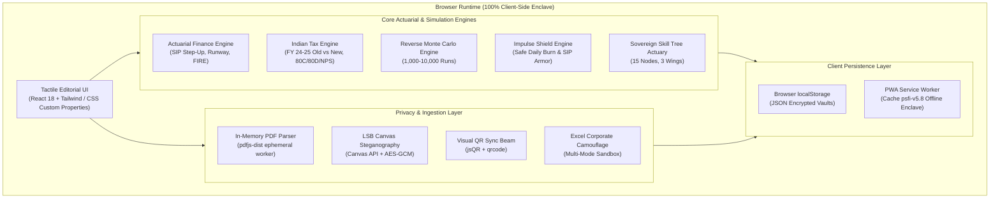

# PsFi System Architecture & Cryptographic Manual

This document details the architectural principles, cryptographic enclaves, actuarial engines, and state management models powering **PsFi (Pseudo Finance Control Center)**.

---

## 1. High-Level System Architecture

PsFi is constructed on a **Zero-Server, Local-First Enclave** topology. The entire application runs natively inside the client's browser runtime with zero reliance on cloud databases, remote API gateways, or tracking servers.

---

## 2. Cryptographic Enclave & Privacy Specifications

### 2.1 Zero-Cloud Isolation Model
- **No Remote Endpoints:** PsFi initiates zero outbound network calls containing user state.
- **In-Memory Document Extraction:** Financial statements (Mutual Fund CAS, Bank PDFs, Credit Card bills, Payslips) are extracted into ephemeral typed arrays via `pdfjs-dist`. Text tokens are processed in volatile memory, extracted into financial balances, and immediately eligible for garbage collection. No document bytes are stored in `localStorage` or transmitted over HTTP.

### 2.2 Steganographic PNG Encryption (Sound & Image Cloaking)
PsFi implements pixel-level Least Significant Bit (LSB) steganography:
1. The active vault state is serialized into JSON.
2. The payload is encrypted using **AES-GCM (256-bit key derived via PBKDF2 with 100,000 SHA-256 iterations)**.
3. The ciphertext and a 16-byte authentication tag are encoded into the least significant bit of the Red, Green, and Blue color channels of an uncompressed canvas image.
4. The output is exported as an authentic PNG image. An external observer inspects a standard wallpaper image; importing the image and supplying the passphrase decrypts the payload back into the vault.

### 2.3 Cross-Device QR Beam (Acoustic & Visual Synchronization)
- Enables P2P synchronization without Bluetooth, WebRTC signaling servers, or cloud intermediaries.
- Large vault payloads are compressed using LZ-string compression, chunked into sequence frames, and rendered as animated high-frequency QR frames.
- The recipient device utilizes `jsQR` to capture and assemble the multi-part payload directly in memory.

---

## 3. Actuarial Calculations & Financial Mathematics

### 3.1 Step-Up Compounding SIP Equation
PsFi calculates terminal wealth with compounding monthly contributions escalating annually by a step-up rate \(s\):

\[
FV = \sum_{y=0}^{Y-1} \left[ P (1 + s)^y \times \sum_{m=1}^{12} \left(1 + \frac{r}{12}\right)^{12(Y - y) - m} \right]
\]

Where:
- \(P\): Base monthly SIP amount (₹)
- \(s\): Annual step-up escalation rate (e.g., \(10\% = 0.10\))
- \(r\): Annual nominal equity CAGR (e.g., \(12\% = 0.12\))
- \(Y\): Investment horizon in years
- \(m\): Month index within year \(y\)

### 3.2 Emergency Runway 3-Tier Survival Math
Let \(L\) be total liquid cash and debt reserves. Runway in months is calculated across 3 distinct survival regimes:

1. **Tier 1 (Barebones Crisis Runway):**
   \[
   Runway_{T1} = \frac{L}{Housing + Essential Utilities}
   \]
2. **Tier 2 (Lean Living Runway):**
   \[
   Runway_{T2} = \frac{L}{Tier_1 + Groceries + Basic Transport}
   \]
3. **Tier 3 (Full Lifestyle Runway):**
   \[
   Runway_{T3} = \frac{L}{Total Monthly Living Overhead}
   \]

### 3.3 Indian Income Tax Engine (FY 2024–25 Union Budget)
- **New Tax Regime Slabs (Section 115BAC):**
  - ₹0 to ₹3,00,000: Nil
  - ₹3,00,001 to ₹7,00,000: 5%
  - ₹7,00,001 to ₹10,00,000: 10%
  - ₹10,00,001 to ₹12,00,000: 15%
  - ₹12,00,001 to ₹15,00,000: 20%
  - Above ₹15,00,000: 30%
  - Standard deduction: ₹75,000.
  - Section 87A rebate: 100% tax rebate up to ₹7,75,000 taxable income.
- **Old Tax Regime Engine:**
  - Standard deduction: ₹50,000.
  - Section 80C deduction: Capped at ₹1,50,000 (EPF, ELSS, PPF, Life Insurance).
  - Section 80D deduction: Up to ₹25,000 (Self/Family) + ₹50,000 (Senior Parents).
  - Section 80CCD(1B): Exclusive NPS deduction up to ₹50,000.
  - House Rent Allowance (HRA): Statutory minimum of actual HRA, 50%/40% of basic, or rent paid minus 10% basic.

---

## 4. State Management & Component Hierarchy

```mermaid
graph TD
    App["App.tsx (Root Controller)"]
    App --> Dock["NavbarDock (Sticky Header)"]
    App --> Gateway["GatewayScreen (Vault Switcher)"]
    App --> Hero["HeroSection (Editorial Intro)"]
    App --> Archetypes["PersonaPresetBar (Calibrated Profiles)"]
    App --> Summaries["SummaryCards (KPI Telemetry)"]
    
    App --> CockpitGrid["CockpitGrid (2-Column Symmetrical Grid)"]
    CockpitGrid --> InflowOutflow["IncomeExpensePanel (Sliders & Categories)"]
    CockpitGrid --> StressTest["EmergencyStressTestWidget (3-Tier Runway)"]
    CockpitGrid --> FireCountdown["FireMilestoneTracker (FIRE Progress)"]
    CockpitGrid --> BudgetHealth["BudgetHealthWidget (50/30/20 Balance)"]
    CockpitGrid --> ImpulseShield["ImpulseShieldWidget (Daily Burn Pocket)"]
    CockpitGrid --> TaxDebt["IndiaTaxAndDebtPanel (Regime Comparison)"]
    
    App --> FullWidthProjections["ProjectionSection (30-Year Wealth Graph)"]
    App --> Terminal["WealthTerminal (Stock & Asset Valuation)"]

    App --> Modals["Modals & Enclaves"]
    Modals --> SkillTree["SovereignSkillTreeModal (Astrolabe Star-Chart)"]
    Modals --> Camouflage["ExcelCamouflageOverlay (4 Corporate Themes)"]
    Modals --> IngestModal["StatementParserModal (CAS & Bank PDF Engine)"]
    Modals --> MonteCarloModal["ReverseMonteCarloModal (Stochastic Sim)"]
    Modals --> SandboxModal["WhatIfSandboxModal (Scenario Sandbox)"]
    Modals --> QRModal["QRVaultSyncModal (Visual P2P Beam)"]
    Modals --> StegoModal["SteganographyModal (PNG LSB Encryption)"]
    Modals --> TourModal["GuidedTourModal (8-Step HUD Tour)"]
```

---

## 5. Offline PWA & Service Worker Caching

The Progressive Web App service worker (`public/sw.js`) operates on cache version `psfi-v5.8`:
- **Pre-Cache on Install:** Caches all core static assets (`index.html`, compiled CSS/JS bundles, fonts, manifest).
- **Cache-First Runtime Strategy:** Serves cached assets instantaneously on repeat visits, providing 100% functionality with zero internet connectivity.
- **Atomic Cache Invalidation:** When a new build deploys, `activate` purges stale cache versions automatically without disrupting the client state.
